# FireBridge: NASA Earth Observation Active Fire Harmonization Platform
## 2026 NASA Space Apps Challenge • Operational Prototype
### Challenge Track: *Harmonization of MODIS and VIIRS Hot Spots*

[](https://earthdata.nasa.gov/)
[](https://firms.modaps.eosdis.nasa.gov/)
[](LICENSE)
[](#)

FireBridge is an Earth Observation decision-support platform designed to solve the structural sensor discontinuity between NASA's historical **MODIS** active fire observations (2000–present, $1\text{ km}$ nadir resolution) and next-generation **VIIRS** observations (2012–present, $375\text{ m}$ resolution).

By applying cross-sensor regression calibration, Empirical Quantile Mapping, Point-Spread Function (PSF) deconvolution, and the Sofiev & Kouznetsov (2026) physical detection threshold operator ($\ge 3.7\text{ MW}$), FireBridge produces a continuous, sensor-agnostic $2000–2026$ active fire climatology that eliminates the artificial $+2.85\times$ to $+3.82\times$ step-jump across global biomes.

---

## 1. Executive Summary & Core Capabilities

- **Split-Screen Command Workbench (Default View):** Interactive Leaflet GIS canvas (CartoDB Dark Matter, NASA GIBS EPSG:3857 True Color & Thermal layers) on the left dynamically driving the Harmonized Burning Activity Calendar and Observation Benchmark Gauge on the right.
- **Continuous 2000–2026 Climatology:** 324 unbroken monthly intervals resolving active fire frequency, Mean Fire Radiative Power (FRP), Fire Radiative Energy (FRE in MJ), and carbon equivalent emissions ($\text{Tg CO}_2$).
- **2012 Sensor Cliff 3-Way Toggle:** Instantly toggle between `[ ✓ Harmonized (Theil-Sen) | ⚠️ Raw Unharmonized (+3.8x) | Δ Bias Removed ]` on both the Burning Calendar and multi-decadal time-series curves.
- **Current Month vs. Historical Median Benchmark:** Real-time bullet gauge comparing the active month observation against the $2000–2025$ historical multi-year median with $25\text{th}–75\text{th}$ interquartile range (IQR) bands and GWIS anomaly hazard badges.
- **Dynamic Custom AOI Spatial Synthesis:** Draw bounding boxes, freehand polygons, or enter manual Lat/Lon coordinates anywhere on Earth to immediately synthesize a 26-year calibrated climatology record without empty states.
- **Month Diagnostic Modal:** Click any month cell in the $2000–2026$ matrix to inspect raw MODIS, raw VIIRS, harmonized counts, diurnal energy (FRE in MJ), carbon emissions, and Z-score deviation.
- **3D Planetary Orbital Swath & Bow-Tie Simulator:** WebGL 3D Earth visualizer tracking orbital mechanics of Terra ($705\text{ km}$), Aqua ($705\text{ km}$), S-NPP ($824\text{ km}$), NOAA-20, and NOAA-21 alongside interactive Viewing Zenith Angle (VZA) bow-tie pixel distortion ($0^\circ$ to $53^\circ$).

---

## 2. The Scientific Challenge: The 2012 Sensor Cliff

In January 2012, NASA's Earth Observation fleet transitioned primary active fire detection from **MODIS** (Terra/Aqua, $1,000\text{ m}$ nadir) to **VIIRS** (Suomi-NPP/NOAA-20/NOAA-21, $375\text{ m}$ I-band). Because VIIRS pixels cover $\sim 7\times$ smaller area ($0.14\text{ km}^2$ vs $1.00\text{ km}^2$), VIIRS detects significantly cooler, smaller smoldering fires:

| Sensor Attribute | MODIS (MCD14ML) | VIIRS (VNP14IMG) | Discrepancy & Operational Impact |
| :--- | :--- | :--- | :--- |
| **Nadir Footprint** | $1.0\text{ km} \times 1.0\text{ km}$ ($1.0\text{ km}^2$) | $375\text{ m} \times 375\text{ m}$ ($0.14\text{ km}^2$) | VIIRS resolves $7.11\times$ smaller ground features |
| **FRP Sensitivity Limit** | $\sim 3.7\text{ MW}$ | $\sim 0.5\text{ MW}$ | VIIRS catches low-intensity smoldering & agricultural burns |
| **Scan Edge Distortion** | Expands to $4.8\times 2.4\text{ km}$ ($11.5\text{ km}^2$) | Constrained to $\le 0.8\text{ km}$ ($0.29\text{ km}^2$) | Severe bow-tie overlap and pixel blooming in MODIS |
| **Raw Catch Rate Ratio** | $1.0\times$ (Baseline) | $2.85\times$ to $3.82\times$ | **Creates the artificial 2012 "Sensor Cliff"** |
| **Thermal Bands** | B21/22 ($3.96\ \mu\text{m}$), B31 ($11.0\ \mu\text{m}$) | I4 ($3.74\ \mu\text{m}$), I5 ($11.45\ \mu\text{m}$) | Differing atmospheric transmission & saturation thresholds |

Uncalibrated data leads emergency managers to mistake sensor resolution upgrades for a climate catastrophe. **FireBridge reconciles the two sensors so the sensor of origin no longer matters.**

---

## 3. Mathematical Harmonization Operators

### A. Theil-Sen Robust Linear Calibration
Robust against extreme pyrocumulonimbus firestorms during the 2012–2026 overlap era:
$$N_{\text{harm}} = \beta \cdot N_{\text{VIIRS}} + \alpha \quad (\beta = 0.2618, \; \alpha = 14.2, \; R^2 = 0.9890, \; \text{RMSE} = 169.2)$$

### B. Sofiev & Kouznetsov (2026) Physical Detection Threshold Operator
Filters out subpixel fires detected exclusively by the $375\text{ m}$ I-band:
$$P_{\text{det}}(\text{FRP}) = 1 - \exp\left(-\gamma \cdot (\text{FRP} - \text{FRP}_{\text{th}})\right), \quad \text{where } \text{FRP}_{\text{th}} \ge 3.7\,\text{MW}$$

### C. Point-Spread Function (PSF) Spatial Convolution ($375\text{ m} \rightarrow 1\text{ km}$)
Convolves neighboring VIIRS hotspots with a 2D Gaussian point-spread kernel matching the MODIS triangular scan-response envelope:
$$\mathcal{H}(x, y) = \frac{1}{2\pi \sigma_x \sigma_y} \exp\left( -\frac{(x - x_0)^2}{2\sigma_x^2} - \frac{(y - y_0)^2}{2\sigma_y^2} \right)$$

### D. Wooster (2005) Fire Radiative Energy (FRE) Biomass Consumption
Converts integrated thermal energy into carbon emissions ($\text{Tg CO}_2$):
$$\text{FRE} = \int_{t_1}^{t_2} \text{FRP}(t)\,dt \quad (\text{MJ}), \qquad M_{\text{biomass}} = C_{\text{FRE}} \cdot \text{FRE}, \quad C_{\text{FRE}} = 0.368 \pm 0.015\,\text{kg/MJ}$$

---

## 4. Architecture & 4 Operational Workbenches

```mermaid
flowchart LR
    subgraph Data ["Data Ingestion"]
        M["MODIS Terra/Aqua Archive"]
        V["VIIRS S-NPP/NOAA Archive"]
        API["NASA FIRMS Live API"]
    end

    subgraph Core ["Scientific Pipeline"]
        D["Dual-Sensor Overlap Alignment"]
        C["Theil-Sen / PSF / Sofiev Operators"]
        B["2000–2025 Climatological Baseline"]
    end

    subgraph UI ["Decision Support UI"]
        W1["1. Command Workbench (Map + Calendar)"]
        W2["2. Sensor Harmonization Lab"]
        W3["3. Climatology & 2050 Intelligence"]
        W4["4. 3D Orbital Swath & Bow-Tie"]
    end

    Data --> Core --> UI
```



### 1. Command Workbench (`#view-workbench` - Default Landing)
- **Left (45% Width):** CartoDB Dark Matter GIS map, NASA GIBS True Color & Thermal Anomalies WMTS layers, clustering, FRP pulsing shockwaves, bounding box and polygon drawing tools, Lat/Lon coordinate drawer, and time player scrubber.
- **Right (55% Width):**
  - **Observation Benchmark Card:** Active month vs. $2000–2025$ historical median bullet gauge, IQR band, and GWIS hazard tier.
  - **Multi-Decadal Burning Activity Calendar:** 27 rows (2000–2026) $\times$ 12 months with 3-way sensor toggle, 5 metrics (Count, FRP, FRE, Carbon, Z-score), 4 palettes, dynamic 5th–95th percentile contrast, and click-to-open **Month Diagnostic Modal**.
  - **Multi-Decadal Climatology Trend & 2012 Sensor Cliff Chart:** Visualizes raw +3.8x jump vs. smooth calibrated climate record.

### 2. Sensor Harmonization Lab (`#view-harmonization`)
- **Optical Split Simulator:** Live side-by-side interactive split comparing $1,000\text{ m}$ MODIS pixel footprints against $375\text{ m}$ VIIRS subpixels.
- **2012 Sensor Cliff Reconciler:** Interactive overlay demonstrating bias elimination.
- **5 Statistical Models:** OLS Overlap, Theil-Sen Robust, Empirical Quantile Mapping, Sofiev Physical Detection, and PSF Convolution.
- **Dozier Subpixel Fire Inverter:** Dual-channel temperature ($T_f$) and subpixel area fraction ($A_f$) inversion.

### 3. Climatology & 2050 Intelligence (`#view-climatology`)
- **Copernicus GWIS Anomaly Engine:** Z-score anomaly distribution across 5 GWIS hazard tiers.
- **Decadal Shifts & Diurnal Night-Burn Escalation:** Quantifies increasing night-time fire intensity due to vapor pressure deficit (VPD) collapse.
- **2026–2050 Climate Projections:** CMIP6 SSP2-4.5 vs. SSP5-8.5 future fire regime scenario projections.

### 4. 3D Orbital Swath & Constellation Environment (`#view-orbit3d`)
- **3D Planetary WebGL Earth:** Real-time orbits of Terra, Aqua, Suomi-NPP, NOAA-20, and NOAA-21 with equatorial crossing and swath footprints.
- **Viewing Zenith Angle (VZA) & Bow-Tie Effect Simulator:** Scan-angle slider ($0^\circ$ to $53^\circ$) demonstrating MODIS $4.8\times$ pixel blooming versus VIIRS 3-to-1 onboard aggregation.

---

## 5. Production REST API Reference

Zero external npm dependencies — built on native Node.js:

| Method | Endpoint | Description |
| :--- | :--- | :--- |
| `GET` | `/api/health` | Service telemetry, memory usage, uptime, constellation status |
| `GET` | `/api/regions` | Returns all 6 global biomes + custom user-saved AOIs |
| `POST` | `/api/regions` | Dynamically registers and synthesizes custom AOI bounding boxes |
| `GET` | `/api/fires` | Filtered hotspot stream (`region`, `sensor`, `min_frp`, `diurnal`, `min_lat`, `max_lat`) |
| `GET` | `/api/fires/summary` | Real-time climatological KPIs, decadal trend, carbon emissions |
| `GET` | `/api/fires/calendar` | 2000–2026 harmonized burning activity matrix with medians & Z-scores |
| `GET` | `/api/quality` | Statistical validation metrics (RMSE, bias, paired t-test, Wilcoxon) |
| `GET` | `/api/export/csv` | Streams filtered observations conforming to NASA FIRMS standard schema |
| `GET` | `/api/export/geojson`| Streams GeoJSON `FeatureCollection` for GIS tools (QGIS, ArcGIS) |
| `POST` | `/api/nasa/sync` | Ingests near-real-time observations via NASA FIRMS API gateway |

---

## 6. Quick Start & Execution

### Prerequisites
- Node.js (v18+ recommended, v24 verified)
- Python 3.10+ (optional, for PDF report compilation)

### Start FireBridge
```bash
# Clone the repository
git clone https://github.com/nasa-spaceapps-2026/firebridge.git
cd firebridge

# Start the zero-dependency production server
npm start
# or: node server.js
```
Open **[http://localhost:3000](http://localhost:3000)** in any modern web browser.

### Run Automated Test Suite
```bash
node test_api.js
# Executes 10/10 automated tests covering REST endpoints, schemas, and calibration algorithms
```

### Compile PDF Incident Commander Briefing
```bash
python generate_pdf_report.py
# Outputs: Harmonizing_MODIS_VIIRS_Fire_Hotspots_Report.pdf
```

---

## 7. Curated Multi-Biome Coverage

FireBridge includes 26-year calibrated climatology datasets for 6 major NASA fire reference biomes:
1. **Northern California (Sierra Nevada):** Conifer fire regime ($36.5^\circ\text{N}–42.0^\circ\text{N},\ 124.5^\circ\text{W}–119.0^\circ\text{W}$).
2. **Amazon Deforestation Arc:** Tropical agricultural & deforestation frontier ($15.0^\circ\text{S}–2.0^\circ\text{S},\ 65.0^\circ\text{W}–48.0^\circ\text{W}$).
3. **SE Australia (Black Summer Zone):** Eucalyptus temperate fire belt ($39.0^\circ\text{S}–28.0^\circ\text{S},\ 145.0^\circ\text{E}–153.5^\circ\text{E}$).
4. **Boreal Siberia (Taiga Permafrost):** High-latitude taiga peat fires ($55.0^\circ\text{N}–68.0^\circ\text{N},\ 90.0^\circ\text{E}–135.0^\circ\text{E}$).
5. **Mediterranean Basin (South EU):** Shrubland & chaparral dry-summer burns ($35.0^\circ\text{N}–44.0^\circ\text{N},\ 10.0^\circ\text{W}–30.0^\circ\text{E}$).
6. **Pantanal Wetlands:** Tropical wetland savanna ($22.0^\circ\text{S}–15.5^\circ\text{S},\ 58.5^\circ\text{W}–55.0^\circ\text{W}$).

---

## 8. License & NASA Citations

Distributed under the MIT / NASA Open Source Agreement.

```bibtex
@misc{firebridge2026,
  title={FireBridge: Harmonization of NASA MODIS and VIIRS Active Fire Hotspots (2000–2026)},
  author={FireBridge Applied Geospatial Team},
  year={2026},
  howpublished={NASA Space Apps Challenge 2026 • Operational Prototype}
}
```
