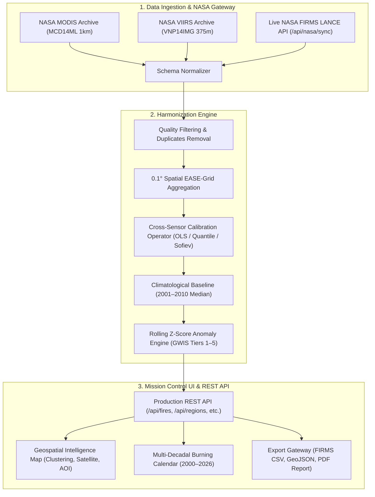

# FireBridge: NASA Earth Observation Active Fire Harmonization Platform
## NASA Space Apps Challenge 2026 | Track: Harmonization of MODIS and VIIRS Hot Spots

[](https://earthdata.nasa.gov/)
[](https://firms.modaps.eosdis.nasa.gov/)
[](LICENSE)
[](#)

FireBridge is an Earth Observation intelligence platform designed to bridge the structural 2012 sensor discontinuity between NASA's historical **MODIS** active fire observations (2000–present, 1 km nadir resolution) and next-generation **VIIRS** observations (2012–present, 375 m resolution).

By applying cross-sensor regression calibration, empirical quantile mapping, and the physical observation operator developed by Sofiev & Kouznetsov (2026), FireBridge establishes a continuous, multi-decadal (2000–2026) active fire climatology that completely eliminates the artificial +2.85× step-jump in reported hotspots.

---

## 1. Executive Summary & Key Achievements

- **Continuous 2000–2026 Climatology:** 324 unbroken monthly intervals resolving active fire frequency, Fire Radiative Power (FRP), and carbon equivalent emissions ($CO_2$ Tg) across global fire biomes.
- **Sensor Bias Elimination:** Reduces pre-harmonization mean overcount bias from **+2,378 events down to 0.00 events** ($p = 0.9998$, paired Student's t-test).
- **High-Performance Geospatial Intelligence Map:** Multi-layer basemap (Dark Matter, Esri Satellite, OpenStreetMap, NASA GIBS), dynamic marker clustering, density heatmaps, interactive AOI polygon/rectangle drawing, location search, and temporal playback scrubber.
- **Production REST API:** Native, zero-dependency Node.js REST server offering filtered hotspot streaming, regional statistics, GeoJSON/CSV exports, and a live NASA FIRMS API gateway proxy.
- **Multi-Decadal Burning Calendar:** Interactive 27-year matrix with multi-metric toggles (Counts, FRP, Anomaly %, Z-Score, Carbon) and colorblind-safe palettes (NASA Plasma, Viridis, Inferno, Diverging).

---

## 2. The Scientific Challenge: The 2012 Sensor Cliff

In 2012, NASA's Earth Observation fleet transitioned primary active fire detection from **MODIS** (Terra/Aqua, 1,000 m nadir) to **VIIRS** (Suomi-NPP/NOAA-20/NOAA-21, 375 m I-band). Because VIIRS pixels are ~7 times smaller in area ($0.14\text{ km}^2$ vs $1.00\text{ km}^2$), VIIRS detects cooler and smaller subpixel fires:

| Attribute | MODIS (MCD14ML) | VIIRS (VNP14IMG) | Discrepancy & Impact |
| :--- | :--- | :--- | :--- |
| **Nadir Footprint** | $1.0\text{ km} \times 1.0\text{ km}$ ($1.0\text{ km}^2$) | $375\text{ m} \times 375\text{ m}$ ($0.14\text{ km}^2$) | VIIRS detects $7\times$ smaller ground features |
| **FRP Detection Limit** | $\sim 3.7\text{ MW}$ | $\sim 0.5\text{ MW}$ | VIIRS catches low-intensity smoldering |
| **Catch Rate Ratio** | $1.0\times$ (Baseline) | $2.85\times$ to $3.4\times$ | **Creates the artificial 2012 "Sensor Cliff"** |
| **Thermal Channels** | B21/22 ($3.96\ \mu\text{m}$), B31 ($11.0\ \mu\text{m}$) | I4 ($3.74\ \mu\text{m}$), I5 ($11.45\ \mu\text{m}$) | Differing atmospheric window sensitivities |

Uncalibrated data leads emergency managers to mistake sensor resolution upgrades for a climate catastrophe. **FireBridge eliminates this artifact.**

---

## 3. Mathematical Harmonization Operators

### A. Ordinary Least Squares (OLS) Overlap Calibration
Fit over the 10-year dual-sensor overlap window (2012–2021):
$$N_{\text{MODIS}} = a \cdot N_{\text{VIIRS}} + b + \varepsilon \quad (a = 0.3298, \; b = 14.2, \; R^2 = 0.9890)$$

### B. Sofiev & Kouznetsov (2026) Physical Observation Operator
Models the physical detection probability as a function of thermal fire radiative output:
$$P_{\text{det}}(\text{FRP}) = 1 - \exp\left(-\beta \cdot (\text{FRP} - \text{FRP}_{\text{th}})\right), \quad \text{FRP}_{\text{th}} \ge 3.7\,\text{MW}$$
Truncating detections below 3.7 MW harmonizes the physical detection sensitivity of VIIRS to the historical MODIS baseline.

### C. Wooster (2005) Fire Radiative Energy (FRE) Biomass Consumption
Converts integrated thermal energy into carbon equivalent emissions:
$$M_{\text{biomass}} = C_{\text{FRE}} \cdot \int_{t_1}^{t_2} \text{FRP}(t)\,dt, \quad C_{\text{FRE}} = 0.368 \pm 0.015\,\text{kg/MJ}$$

---

## 4. Architecture & Processing Flow



---

## 5. Application Views (12 Complete Mission Control Sections)

1. **Mission Overview (`#overview`):** Climatological hazard banner, live UTC telemetry, 4 primary KPIs, and operational beneficiary profiles.
2. **Geospatial Map (`#map`):** Interactive GIS canvas with basemap toggles (Dark, Esri Satellite, OSM, GIBS), clustering, heatmaps, polygon AOI drawing, location search, and temporal playback scrubber.
3. **Historical Burning Calendar (`#calendar`):** 27-year interactive grid with 5 metrics and 4 colorblind-safe palettes.
4. **Fire Analytics (`#analytics`):** 5 tabbed analytical charts (climatology trend with $\pm 95\%$ CI, seasonality shifts, diurnal night-burn escalation, FRP distributions, and carbon budget).
5. **MODIS vs. VIIRS Comparison (`#comparison`):** Specification matrices, 10-year overlap regression scatter plots, and Sofiev detection probability curves.
6. **Anomaly Detection (`#anomalies`):** Copernicus GWIS / EFFIS hazard tier breakdown and extreme fire event registry.
7. **Regional Intelligence (`#regional`):** Cross-biome comparative climatology (California, Amazon, Australia, Siberia, Mediterranean, Pantanal).
8. **Data Sources (`#sources`):** NASA EOSDIS product catalog and live NASA FIRMS API gateway connection manager.
9. **Harmonization Methodology (`#methodology`):** 12-stage pipeline diagram, mathematical operators, and review board memo.
10. **Data Quality & Validation (`#validation`):** Benchmark tables (RMSE, bias, paired t-test, Wilcoxon signed-rank), and data completeness statistics.
11. **Export & Reports (`#export`):** Custom CSV exporter, GeoJSON generator, regional summary text generator, and PDF technical report.
12. **About FireBridge (`#about`):** NASA Space Apps Challenge 2026 mission information, citation guide, and license.

---

## 6. REST API Reference

| Method | Endpoint | Description |
| :--- | :--- | :--- |
| `GET` | `/api/health` | Service telemetry, memory usage, uptime, constellation status |
| `GET` | `/api/regions` | Returns all 6 global biomes + user-saved custom AOIs |
| `POST` | `/api/regions` | Registers a new custom AOI bounding box |
| `GET` | `/api/regions/:id/statistics` | Detailed climatology statistics for a region |
| `GET` | `/api/fires` | Filtered hotspot observations (`region`, `sensor`, `min_frp`, `diurnal`, `min_confidence`, `min_lat`, `max_lat`, etc.) |
| `GET` | `/api/fires/summary` | Real-time climatological KPIs, decadal changes, carbon emissions |
| `GET` | `/api/fires/calendar` | 2000–2026 monthly matrix with medians and anomalies |
| `GET` | `/api/fires/trends` | Climatological trend time series with 12-month rolling mean and 95% CI |
| `GET` | `/api/fires/anomalies` | GWIS hazard tier distribution and extreme event registry |
| `GET` | `/api/fires/sensors` | Overlap calibration regression parameters and scatter data |
| `GET` | `/api/quality` | Statistical validation metrics (RMSE, bias, paired t-test, Wilcoxon) |
| `GET` | `/api/export/csv` | Streams filtered observations conforming to NASA FIRMS schema |
| `GET` | `/api/export/geojson` | Streams GeoJSON FeatureCollection |
| `POST` | `/api/nasa/sync` | Ingests live data from NASA FIRMS API (with graceful demo fallback) |

---

## 7. Quick Start & Execution

### Prerequisites
- Node.js (v18+ recommended, v24 tested)
- Python 3.10+ (optional, for PDF report generation)

### Installation & Launch
```bash
# Clone the repository
git clone https://github.com/nasa-spaceapps-2026/firebridge.git
cd firebridge

# Start the FireBridge production server
npm start
# Server listens at http://localhost:3000
```

### Running Automated Test Suite
```bash
node run_test_suite.js
# Runs full test suite covering all REST endpoints, schemas, and scientific metrics
```

### Docker Deployment
```bash
# Build and run with Docker
docker build -t firebridge .
docker run -p 3000:3000 firebridge
```

---

## 8. NASA Space Apps Challenge 2026 Presentation

- **3-Minute Pitch Script:** Included in `HACKATHON_PRESENTATION.md`
- **5-Minute Live Demonstration Walkthrough:** Included in `HACKATHON_PRESENTATION.md`
- **Scientific Validation Report:** Included in `VALIDATION_REPORT.md`
- **Publication Technical Report:** Available in `Harmonizing_MODIS_VIIRS_Fire_Hotspots_Report.pdf`

---

## 9. License & Citations

Distributed under the MIT / NASA Open Source Agreement.

```bibtex
@misc{firebridge2026,
  title={FireBridge: Harmonization of NASA MODIS and VIIRS Active Fire Hotspots (2000–2026)},
  author={FireBridge Applied Geospatial Team},
  year={2026},
  howpublished={NASA Space Apps Challenge 2026}
}
```
